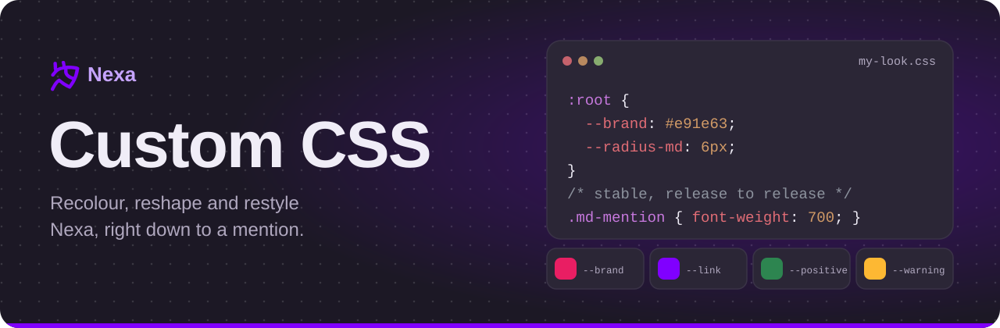
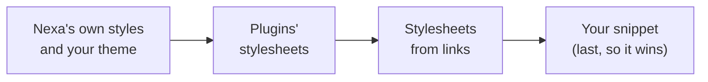

<p align="center">
  <picture>
    <source media="(prefers-color-scheme: dark)" srcset="assets/custom-css-banner-dark.svg">
    <source media="(prefers-color-scheme: light)" srcset="assets/custom-css-banner-light.svg">
    
  </picture>
</p>

<p align="center">
  
  
  
</p>

<p align="center">
  <a href="#getting-started"><b>Getting Started</b></a>
  &nbsp;&nbsp;|&nbsp;&nbsp;
  <a href="#colours"><b>Colours</b></a>
  &nbsp;&nbsp;|&nbsp;&nbsp;
  <a href="#selecting-things"><b>Selecting Things</b></a>
  &nbsp;&nbsp;|&nbsp;&nbsp;
  <a href="#snippets"><b>Snippets</b></a>
  &nbsp;&nbsp;|&nbsp;&nbsp;
  <a href="plugins.md"><b>Plugins</b></a>
</p>

Custom CSS changes how Nexa looks with stylesheets you write yourself or load
from a link. It lives in **Settings, Custom CSS**, follows your account to
every device you sign in on, and works in the browser and in the desktop app.
The Android app does not run custom CSS.

> [!WARNING]
> **CSS from other people can do more than change colours.** A stylesheet can
> hide buttons, move things around, or load pictures and fonts from other
> sites (which tells those sites your address). Only add stylesheets from
> people you trust, and read what you paste.

<table>
<tr>
<td width="50%" valign="top">

### Contents

- [Getting Started](#getting-started)
- [How Your CSS Is Applied](#how-your-css-is-applied)
- [Colours](#colours)
- [Type, Shape and Size](#type-shape-and-size)
- [Selecting Things](#selecting-things)
- [Snippets](#snippets)
- [Sharing a Theme](#sharing-a-theme)
- [When Something Goes Wrong](#when-something-goes-wrong)

</td>
<td width="50%" valign="top">

### Before You Write CSS

Most looks need no CSS at all. **Settings, Appearance** has preset themes, a
theme builder that sets every colour below with a picker (and exports and
imports themes), the accent colour, the font, the text size and Reduce
Motion. Reach for custom CSS when you want something those cannot do.

</td>
</tr>
</table>

---

## Getting Started

1. Open **Settings, Custom CSS**.
2. Type into the editor. The whole app shows what you type while the page is
   open, so you see each change at once.
3. Press **Save CSS**. Your snippet now follows your account.

Try this first:

```css
:root {
  --brand: #e91e63;          /* the accent: buttons, unread pills, focus */
  --text-brand: #ff8fb8;     /* the accent used as text */
  --radius-md: 6px;          /* squarer cards and dialogs */
}
```

The **Use my CSS** switch turns the snippet off without losing it.

### Stylesheets From Links

Under **Themes from Links**, **Add a Link** loads a `.css` file from an https
address. Each one has its own switch, and you can have up to 20.

- Each device keeps a copy of every stylesheet from a link, so Nexa starts
  styled even when the site is down.
- Nexa checks each link for a new version once a day in the background;
  **Refresh** fetches it at once.
- A file can be up to 1 MB. The snippet you type can be up to 64 KB.

## How Your CSS Is Applied

Stylesheets are drawn after all of Nexa's own, in this order, so later ones win
when two rules are equally specific:



A rule as specific as the app's wins because it comes later. When the app's
rule is more specific than yours, match its specificity or add `!important`.

## Colours

Every colour in Nexa is a CSS custom property, and the theme you wear sets all
of them. Setting one on `:root` changes it everywhere it is used, in every
theme:

```css
:root {
  --bg-raised: #101418;
  --mention-bg: rgba(46, 128, 82, 0.28);
  --mention-fg: #8ce0b0;
}
```

These are the same colours the theme builder's **Advanced** mode lists, with
the names it shows. The values are those of the Dark and Light themes; a
preset or a theme you built sets its own.

<!-- the tables below are the theme builder's list (web/src/lib/look/tokens.ts) with Dark's and Light's values from web/src/styles/tokens.css -->

<details>
<summary><b>🖼️ Backgrounds</b> (8)</summary>

| Variable | What it colours | Dark | Light |
| --- | --- | --- | --- |
| `--bg-base` | Sidebar and App Background | `#1c1825` | `#f4f2fb` |
| `--bg-raised` | Message Area | `#221d2b` | `#ffffff` |
| `--bg-surface` | Cards and Panels | `#2b2636` | `#eae8f3` |
| `--bg-floating` | Menus and Pop-Ups | `#282331` | `#ffffff` |
| `--bg-input` | Text Boxes | `#15121c` | `#ebe9f4` |
| `--bg-composer` | Message Box | `#2b2636` | `#edebf5` |
| `--embed-bg` | Link Previews | `#272231` | `#f5f3fb` |
| `--bg-overlay` | Behind Dialogs | `rgba(6, 3, 14, 0.74)` | `rgba(28, 18, 50, 0.46)` |

</details>

<details>
<summary><b>👆 Hover and Selection</b> (6)</summary>

| Variable | What it colours | Dark | Light |
| --- | --- | --- | --- |
| `--bg-hover` | Under the Pointer | `rgba(166, 156, 196, 0.08)` | `rgba(101, 94, 125, 0.09)` |
| `--bg-selected` | Selected Row | `rgba(166, 156, 196, 0.13)` | `rgba(101, 94, 125, 0.14)` |
| `--bg-active` | Pressed Row | `rgba(166, 156, 196, 0.17)` | `rgba(101, 94, 125, 0.2)` |
| `--bg-message-hover` | Message Under the Pointer | `rgba(166, 156, 196, 0.05)` | `rgba(101, 94, 125, 0.05)` |
| `--scroll-thumb` | Scroll Bar | `rgba(166, 156, 196, 0.24)` | `rgba(101, 94, 125, 0.32)` |
| `--scroll-thumb-hover` | Scroll Bar Under the Pointer | `rgba(166, 156, 196, 0.42)` | `rgba(101, 94, 125, 0.52)` |

</details>

<details>
<summary><b>🔤 Text</b> (8)</summary>

| Variable | What it colours | Dark | Light |
| --- | --- | --- | --- |
| `--text-strong` | Headings and Names | `#ffffff` | `#1f1c28` |
| `--text` | Body Text | `#f0edf7` | `#2e2c37` |
| `--text-subtle` | Secondary Text | `#d0cadb` | `#595565` |
| `--text-muted` | Muted Text | `#b0a8bf` | `#595667` |
| `--text-channel` | Channel Names | `#a39bb3` | `#5f5b6c` |
| `--text-placeholder` | Placeholder Text | `#928ba5` | `#6c6877` |
| `--icon` | Icons | `#bcb4cb` | `#514d5f` |
| `--link` | Links | `#86b8f7` | `#0062c0` |

</details>

<details>
<summary><b>💜 Accent</b> (9)</summary>

| Variable | What it colours | Dark | Light |
| --- | --- | --- | --- |
| `--brand` | Accent | `#8000ff` | same |
| `--brand-hover` | Accent Under the Pointer | `#6a00d6` | same |
| `--brand-active` | Accent When Pressed | `#5600ac` | same |
| `--on-brand` | Text on the Accent | `#ffffff` | same |
| `--text-brand` | Accent as Text | `#c6a4ff` | `#6a00d6` |
| `--focus-ring` | Keyboard Focus Ring | `#b77aff` | `#8000ff` |
| `--mention-bg` | Mention Highlight | `rgba(128, 0, 255, 0.24)` | `rgba(128, 0, 255, 0.16)` |
| `--mention-bg-hover` | Mention Under the Pointer | `rgba(128, 0, 255, 0.38)` | `rgba(128, 0, 255, 0.32)` |
| `--mention-fg` | Mention Text | `#e0d0ff` | `#4a1a8f` |

</details>

<details>
<summary><b>📏 Lines</b> (3)</summary>

| Variable | What it colours | Dark | Light |
| --- | --- | --- | --- |
| `--border-subtle` | Faint Lines | `rgba(166, 156, 196, 0.11)` | `rgba(141, 136, 162, 0.26)` |
| `--border` | Lines | `rgba(166, 156, 196, 0.19)` | `rgba(141, 136, 162, 0.38)` |
| `--border-strong` | Strong Lines | `rgba(166, 156, 196, 0.4)` | `rgba(141, 136, 162, 0.52)` |

</details>

<details>
<summary><b>🚦 Status</b> (14)</summary>

| Variable | What it colours | Dark | Light |
| --- | --- | --- | --- |
| `--positive` | Positive Buttons | `#2d8550` | `#1f7d47` |
| `--positive-hover` | Positive Under the Pointer | `#256e42` | `#196a3c` |
| `--on-positive` | Text on Positive | `#ffffff` | same |
| `--warning` | Warning Fill | `#fdb833` | `#bb7300` |
| `--text-warning` | Warning Text | `#fdb833` | `#7a4b00` |
| `--on-warning` | Text on Warning | `#111214` | same |
| `--danger` | Danger Buttons | `#d1343b` | `#d1343b` |
| `--danger-hover` | Danger Under the Pointer | `#b02a31` | `#b02a31` |
| `--on-danger` | Text on Danger | `#ffffff` | same |
| `--text-danger` | Error Text | `#ff8a8e` | `#ab1e29` |
| `--status-online` | Online | `#46b56e` | `#2a7044` |
| `--status-idle` | Idle | `#f0b232` | `#845a06` |
| `--status-dnd` | Do Not Disturb | `#ff7075` | `#c0222c` |
| `--status-offline` | Offline | `#a39cb1` | `#6b6776` |

</details>

<details>
<summary><b>🧩 Code, Tooltips and Spoilers</b> (13)</summary>

| Variable | What it colours | Dark | Light |
| --- | --- | --- | --- |
| `--tooltip-bg` | Tooltip | `#0e0b14` | `#282336` |
| `--tooltip-text` | Tooltip Text | `#f5f3fa` | `#f7f6fa` |
| `--spoiler` | Hidden Spoiler | `#7d768a` | `#93909e` |
| `--spoiler-revealed` | Revealed Spoiler | `#15121c` | `#eae8f3` |
| `--code-bg` | Code Background | `#15121c` | `#f5f3fb` |
| `--code-border` | Code Border | `rgba(166, 156, 196, 0.12)` | `rgba(141, 136, 162, 0.26)` |
| `--code-keyword` | Code Keywords | `#c678dd` | `#cf222e` |
| `--code-string` | Code Strings | `#98c379` | `#0a3069` |
| `--code-number` | Code Numbers | `#d19a66` | `#0550ae` |
| `--code-comment` | Code Comments | `#8d939e` | `#636b75` |
| `--code-title` | Code Function Names | `#61afef` | `#7a3fd4` |
| `--code-type` | Code Types | `#e5c07b` | `#116329` |
| `--code-variable` | Code Variables | `#e06c75` | `#953800` |

</details>

> [!TIP]
> To set a colour for one theme only, scope it to that theme. See
> [The page](#the-page) for the attributes to use.

## Type, Shape and Size

| Variable | What it is |
| --- | --- |
| `--font` | The body font stack. Keep `"Twemoji Text"` first if you want emoji to match the ones in messages. |
| `--font-display` | Names and titles. |
| `--font-mono` | Code. |
| `--radius-xs`, `--radius-sm`, `--radius-md`, `--radius-lg`, `--radius-xl` | Corner radii, from small controls (6px) to large sheets (28px). |
| `--radius-pill` | Fully round ends. |
| `--font-scale` | The text size chosen in Appearance, from `0.75` to `1.5`. Nexa sets it on the page itself, so read it rather than setting it. |

```css
@import url("https://fonts.googleapis.com/css2?family=Atkinson+Hyperlegible:wght@400;700&display=swap");

:root {
  --font: "Twemoji Text", "Atkinson Hyperlegible", system-ui, sans-serif;
  --radius-sm: 4px;
  --radius-md: 6px;
  --radius-lg: 8px;
}
```

Stylesheets may `@import` other stylesheets and load fonts and images over
https.

## Selecting Things

Nexa's components use CSS modules, so most class names carry a hash that
changes between releases (`._rail_7kwj7_2`). Prefer what stays the same, in
this order:

| Prefer | Stays the same? | Example |
| --- | :-: | --- |
| 1. Custom properties | ✅ always | `:root { --brand: … }` |
| 2. Attributes on the page and on messages | ✅ always | `[data-look="forest"]`, `[role="article"][data-mentioned="true"]` |
| 3. Classes of rendered message text | ✅ always | `.md-mention`, `.md-codeblock` |
| 4. The stable start of a hashed class | ⚠️ usually | `[class*="_rail_"]` |

### The Page

These attributes sit on `<html>`, for CSS that should apply in only some
situations.

| Attribute | Values |
| --- | --- |
| `data-look` | The theme being worn: `dark`, `light`, `ash`, `onyx`, a preset (`nexa`, `midnight`, `forest`, `rose`, `amber`, `ocean`, their `-light` versions, `greyscale`, `contrast`, ...), a seasonal theme, or `custom-…` for one you built. |
| `data-scheme` | `dark` or `light`, whatever the theme. |
| `data-theme` | The classic theme under it: `light`, `ash` or `onyx`; missing for Dark. |
| `data-reduced-motion` | `"true"` when Reduce Motion is on. |
| `data-underline-links` | `"true"` when links are underlined. |
| `data-animate-names` | `"false"` when animated names are turned off. |

```css
/* only in light themes */
[data-scheme="light"] { --mention-bg: rgba(233, 30, 99, 0.14); }

/* only in Forest */
[data-look="forest"] { --link: #6fd39b; }

/* honour Reduce Motion in anything you animate */
[data-reduced-motion="true"] .md-mention { transition: none; }
```

### Messages

Every message is an element with `role="article"` and `data-id` (the
message's id). Rows in the message list, messages and the lines between them,
carry `data-row`.

| Attribute on a message | When |
| --- | --- |
| `data-group-start="true"` | It starts a group and shows the author's name. |
| `data-mentioned="true"` | It mentions you. |
| `data-highlight="true"` | It was jumped to, from a reply, search or a link. |
| `data-reply="true"` | It is a reply. |
| `data-pending="true"`, `data-failed="true"` | It is still sending, or failed to send. |
| `data-ephemeral` | Only you can see it (an app's answer). |

The author's name is a button with `data-author` set to their user id (and
`data-webhook` for a webhook), so you can style one person:

```css
[data-author="123456789012345678"] { color: #ffb86b !important; }
```

### Message Text

What people write is drawn with plain class names that never change:

| Class | What it is |
| --- | --- |
| `.md-paragraph` | A paragraph |
| `.md-link`, `.md-link-host` | A link, and the site name shown after a disguised one |
| `.md-mention` | A mention of a person, role or channel |
| `.md-timestamp` | A `<t:…>` time |
| `.md-inline-code` | `inline code` |
| `.md-codeblock-wrap`, `.md-codeblock`, `.md-code-copy` | A code block, its code and its copy button |
| `.md-quote` | A `>` quote |
| `.md-spoiler`, `.md-spoiler-inner` | A spoiler |
| `.md-alert`, `.md-alert-title` | A `> [!NOTE]` style alert |
| `.md-details`, `.md-summary`, `.md-details-body` | A collapsible section |
| `.md-table-wrap`, `.md-table` | A table |
| `.md-task` | A task list's tick box |
| `.md-hr` | A horizontal line |
| `.md-subtext` | `-#` small text |
| `.md-mark`, `.md-sub`, `.md-sup` | Highlighted, subscript and superscript text |
| `.md-footnotes`, `.md-fnref` | Footnotes |
| `.md-emoji-box` | An emoji |

### Everything Else

For the rest of the app, match the stable start of a hashed class:
`[class*="_rail_"]` matches every class whose name was `rail` in the source.
Short names like `_list_` appear in many places, so narrow them with something
around them. Look up names with your browser's developer tools
(right-click, **Inspect**). They usually survive releases, but not always, so
check your stylesheet after an update.

## Snippets

Copy, paste, change. Each one stands alone.

<details>
<summary><b>💜 A different accent everywhere</b></summary>

```css
:root {
  --brand: #12a37f;
  --brand-hover: #0e8a6b;
  --brand-active: #0b7259;
  --text-brand: #5fd6b4;
  --focus-ring: #5fd6b4;
  --mention-bg: rgba(18, 163, 127, 0.22);
  --mention-fg: #8fe8cf;
}
```

</details>

<details>
<summary><b>🔔 Make mentions of you stand out</b></summary>

```css
[role="article"][data-mentioned="true"] {
  background: color-mix(in srgb, var(--warning) 12%, transparent);
  box-shadow: inset 3px 0 0 var(--warning);
}
```

</details>

<details>
<summary><b>💻 Bigger, rounder code blocks</b></summary>

```css
.md-codeblock-wrap { border-radius: var(--radius-md); }
.md-codeblock { font-size: 14px; line-height: 1.6; }
.md-inline-code { padding: 1px 6px; border-radius: 6px; }
```

</details>

<details>
<summary><b>🙈 Spoilers that blur instead of block</b></summary>

```css
.md-spoiler[data-revealed="false"] { background: transparent; color: inherit; }
.md-spoiler[data-revealed="false"] .md-spoiler-inner { visibility: visible; filter: blur(5px); }
```

</details>

<details>
<summary><b>🌓 Different colours in light and dark themes</b></summary>

```css
[data-scheme="dark"]  { --link: #8ab4ff; }
[data-scheme="light"] { --link: #1a56d6; }
```

</details>

<details>
<summary><b>🧱 Square corners</b></summary>

```css
:root {
  --radius-xs: 0;
  --radius-sm: 0;
  --radius-md: 0;
  --radius-lg: 0;
  --radius-xl: 0;
}
```

</details>

<details>
<summary><b>🔗 Underline every link</b></summary>

```css
.md-link { text-decoration: underline; text-underline-offset: 2px; }
```

</details>

## Sharing a Theme

1. Put your CSS in a `.css` file.
2. Host it somewhere that serves it over https and lets other pages fetch it.
   A GitHub repository through `raw.githubusercontent.com` or
   `cdn.jsdelivr.net/gh/...` works.
3. Give people the link. They add it with **Add a Link**, and they get your
   changes within a day of you making them.

> [!TIP]
> A theme made only of colours is easier to share as a theme: build it in
> **Settings, Appearance**, then export it. People import it there, without
> any CSS.

## When Something Goes Wrong

| Problem | Try |
| --- | --- |
| A rule does nothing | Nexa's own rule is more specific. Inspect the element, then match its selector or add `!important`. |
| It stopped working after an update | A hashed class name changed. Switch to a custom property, an attribute or an `.md-` class. |
| The app is unusable | Open Nexa with `?safe` at the end of the address. Custom CSS and plugins are off for that tab, so you can fix or turn off the stylesheet. |
| A link will not load | The site must serve the file over https and allow other pages to fetch it. The Custom CSS page says why it failed. |

---

<p align="center">
  Want to change what Nexa does, not only how it looks? Read the <a href="plugins.md"><b>Plugin guide</b></a>.
  Plugins can add stylesheets too, with <a href="plugins.md#styles"><code>api.styles</code></a>.
</p>
