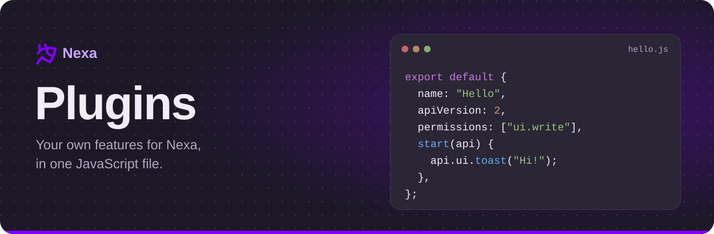
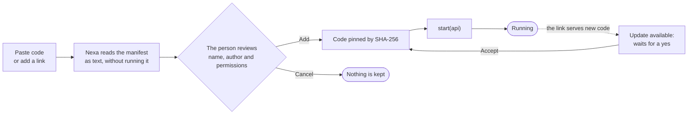
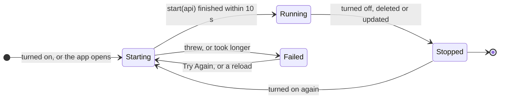
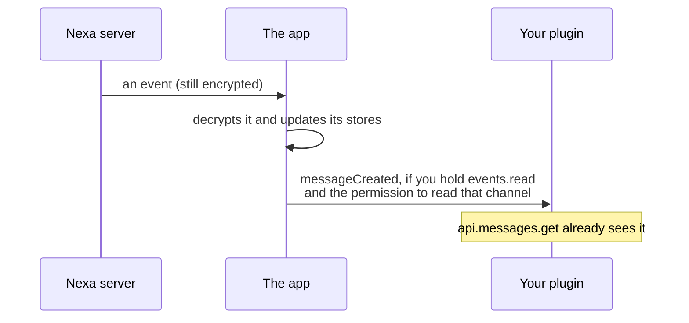

<p align="center">
  <picture>
    <source media="(prefers-color-scheme: dark)" srcset="assets/plugins-banner-dark.svg">
    <source media="(prefers-color-scheme: light)" srcset="assets/plugins-banner-light.svg">
    
  </picture>
</p>

<p align="center">
  
  
  
  <a href="../LICENSE"></a>
</p>

<p align="center">
  <a href="#your-first-plugin"><b>Your First Plugin</b></a>
  &nbsp;&nbsp;|&nbsp;&nbsp;
  <a href="#permissions"><b>Permissions</b></a>
  &nbsp;&nbsp;|&nbsp;&nbsp;
  <a href="#api-reference"><b>API Reference</b></a>
  &nbsp;&nbsp;|&nbsp;&nbsp;
  <a href="#recipes"><b>Recipes</b></a>
  &nbsp;&nbsp;|&nbsp;&nbsp;
  <a href="custom-css.md"><b>Custom CSS</b></a>
</p>

Plugins are JavaScript modules that people write themselves and add in
**Settings, Plugins**. They follow the account to every device it signs in on
and run in the browser and in the desktop app. The Android app does not run
them.

> [!CAUTION]
> **A plugin is not a sandbox.** It runs inside the app, in the same page as
> everything else. Version 2 plugins ask for permissions, and the API refuses
> whatever a plugin was not granted, but nothing stops a plugin's code from
> reaching past the API. Only install plugins whose author you trust.

<table>
<tr>
<td width="33%" valign="top">

### Start Here

- [Before You Start](#before-you-start)
- [Your First Plugin](#your-first-plugin)
- [The Manifest](#the-manifest)
- [Installing](#installing)
- [Starting and Stopping](#starting-and-stopping)
- [Permissions](#permissions)

</td>
<td width="33%" valign="top">

### Reference

- [Users](#users) and [Presence](#presence)
- [Servers](#servers), [Roles](#roles), [Members](#members), [Emoji](#emoji)
- [Channels](#channels) and [Messages](#messages)
- [Events](#events)
- [Commands](#commands) and [Keybinds](#keybinds)
- [Styles](#styles), [Storage](#storage), [Settings](#settings)
- [User Interface](#user-interface) and [Context Menus](#context-menus)
- [Message Box](#message-box), [Navigation](#navigation), [Utilities](#utilities)

</td>
<td width="33%" valign="top">

### Going Further

- [Recipes](#recipes)
- [Example plugins](#example-plugins)
- [What's New in the API](#whats-new-in-the-api)
- [Version 1 Reference](#version-1-reference)
- [Custom CSS guide](custom-css.md)

</td>
</tr>
</table>

---

## Before You Start

Three things keep plugins honest.

| | Guard | What it means |
| :-: | --- | --- |
| 📌 | **Pinned code** | When a plugin is added, the SHA-256 of its exact code is saved with it, and only code with that hash is ever run for it. Pasted code is checked against the hash. Code from a link is kept on each device by its hash, and when the link later serves anything else, the new code waits on the Plugins page under "Update available" until the person has looked at it and said yes. Nothing is updated silently. |
| 📦 | **Self-contained modules** | Plugins run from `blob:` module URLs made from the pinned code. The page's content security policy lets scripts come only from Nexa itself and those `blob:` URLs, and forbids `eval`, so a plugin cannot pull in more code from the network past its hash. Bundle everything into one file. |
| 🛟 | **Safe mode** | Opening Nexa with `?safe` at the end of the address, or pressing "Start in safe mode" on the crash screen, starts it with custom CSS and plugins off for that tab. A plugin that throws while starting is turned off until the next reload, with a note saying so; one that took the page down while starting is skipped on the next start; and when the app crashes twice within ten minutes while plugins run, plugins start off. |



## Your First Plugin

A plugin is one JavaScript module whose default export describes it.

1. Copy this:

   ```js
   export default {
     name: "Hello",
     description: "Says hello when it starts.",
     version: "1.0.0",
     author: "You",
     apiVersion: 2,
     permissions: ["users.self.read", "ui.write"],

     start(api) {
       api.ui.toast(`Hello, ${api.users.me.displayName}!`, { type: "success" });
     },
   };
   ```

2. In Nexa, open **Settings, Plugins**, press **Paste Code** and paste it.
3. The next screen shows what the plugin is and the permissions it asks for.
   Tick the box and press **Add**. A toast says hello.

> [!TIP]
> Open the browser's developer tools while you work. Whatever a plugin's
> callbacks throw is logged there with the plugin's name, and nothing it throws
> can break the app.

### The Manifest

| Field | Required | What it is |
| --- | :-: | --- |
| `name` | ✅ | The plugin's name, shown on the Plugins page and in front of its toasts. |
| `description` | | One sentence on what it does. |
| `version` | | Its version, shown beside the name. |
| `author` | | Who wrote it. |
| `apiVersion` | | `2` for the API on this page. `1`, or none at all, gets [version 1](#version-1-reference). Any other number does not start. |
| `permissions` | | The [permissions](#permissions) a version 2 plugin asks for. |
| `settings` | | Settings the Plugins page draws a form for (see [Settings](#settings)). |
| `start(api)` | ✅ | Called with the API when the plugin starts. |
| `stop()` | | Called when it stops. |

> [!IMPORTANT]
> **Write the manifest out plainly.** Nexa never runs a plugin's code before
> the person has agreed to install it, so the name, description, version,
> author, `apiVersion` and `permissions` are read from the code as text. Write
> them as plain literals in the default export: numbers for `apiVersion`,
> strings for the rest, and a list of strings for `permissions`. A list built
> any other way (a variable, a spread, a function call) is not read, and the
> plugin is installed with no permissions; the person can still grant them on
> the Plugins page.

### Installing

Host the file somewhere that serves it over https and allows other pages to
fetch it (raw.githubusercontent.com and cdn.jsdelivr.net do), then add the
link on the Plugins page, or paste the code there.

| Kind | Limit |
| --- | --: |
| Pasted code, each plugin | 64 KB |
| All pasted plugins together | 256 KB |
| Code from a link | 1 MB |

Pasted code is kept in the account's encrypted settings, which is why it has
the smaller limits.

### Starting and Stopping



- `start(api)` may be `async`. It has 10 seconds; a plugin that takes longer
  is stopped and marked as failed.
- `stop()` may be `async` too, and has 3 seconds.
- Everything a plugin registers through the API is taken away when it stops:
  event listeners, commands, keybinds, context menu changes and stylesheets
  (except those added with [`persist`](#styles)). Plugins can be turned off and
  on without a reload, and most need no `stop()` at all.
- Keep the module's top level free of side effects. The module may be loaded
  more than once.
- A plugin is known by its id, which Nexa gives it when it is added and which
  stays the same through updates. Its storage, settings and keybinds are kept
  by that id, so two plugins with the same name never share them.

## Permissions

A version 2 plugin lists what it means to do in `permissions`. When it is
added, the person sees every permission in plain words and agrees to all of
them, or does not install the plugin. Later they can switch any of them off,
or back on, under the plugin's **Permissions** button on the Plugins page; the
change applies at once, without a restart.

When new code for a plugin (an update from its link, or edited pasted code)
asks for something it was not granted before, the person is asked again and
sees what is new. Permissions the new code no longer asks for are dropped.

Calling a method without its permission throws a `PermissionError`, whose
`permission` names what was missing. A method that returns a `Promise` rejects
with it instead. Events a plugin may not see are simply not delivered, and
fields of objects it may not see are `null`.

```js
try {
  api.servers.list();
} catch (err) {
  if (err.name === "PermissionError") api.ui.toast(`I need ${err.permission} for that.`);
}
```

<table>
<thead><tr><th>Area</th><th>Permission</th><th>What it allows</th></tr></thead>
<tbody>
<tr><td rowspan="5">👤 <b>People</b></td><td><code>users.read</code></td><td>Reading other people's profiles and presence.</td></tr>
<tr><td><code>users.self.read</code></td><td>Reading your own account (<code>users.me</code>).</td></tr>
<tr><td><code>users.self.write</code></td><td>Changing your profile: names, about me, colours, status, typing style.</td></tr>
<tr><td><code>users.relationships.read</code></td><td>Seeing friends, requests and blocks.</td></tr>
<tr><td><code>users.relationships.write</code></td><td>Adding and removing friends, blocking and unblocking.</td></tr>
<tr><td rowspan="2">✉️ <b>Direct messages</b></td><td><code>directmessages.read</code></td><td>Reading direct messages and group conversations, and their messages.</td></tr>
<tr><td><code>directmessages.write</code></td><td>Opening conversations and sending, editing, deleting, pinning and reacting to messages in them.</td></tr>
<tr><td rowspan="8">🏠 <b>Servers</b></td><td><code>servers.read</code></td><td>Reading the servers you are in, and their emoji.</td></tr>
<tr><td><code>servers.write</code></td><td>Creating, changing and leaving servers, and managing roles.</td></tr>
<tr><td><code>servers.members.read</code></td><td>Reading the members of servers.</td></tr>
<tr><td><code>servers.members.write</code></td><td>Changing members: nicknames, roles, timeouts, kicks and bans.</td></tr>
<tr><td><code>servers.channels.read</code></td><td>Reading servers' channels and threads.</td></tr>
<tr><td><code>servers.channels.write</code></td><td>Creating, changing and deleting channels, and threads and forum posts.</td></tr>
<tr><td><code>servers.messages.read</code></td><td>Reading messages in servers.</td></tr>
<tr><td><code>servers.messages.write</code></td><td>Sending, editing, deleting, pinning and reacting to messages in servers.</td></tr>
<tr><td rowspan="2">📡 <b>Events</b></td><td><code>events.read</code></td><td>Listening for events. Each event also needs the permission for what it is about.</td></tr>
<tr><td><code>events.write</code></td><td>Firing its own events for other plugins.</td></tr>
<tr><td rowspan="3">⌨️ <b>Input</b></td><td><code>commands.write</code></td><td>Adding <code>/</code> commands to the message box.</td></tr>
<tr><td><code>keybinds.read</code></td><td>Reading which keys its keybinds are set to.</td></tr>
<tr><td><code>keybinds.write</code></td><td>Adding keybinds.</td></tr>
<tr><td rowspan="2">💾 <b>Storage</b></td><td><code>storage.read</code></td><td>Reading what it stored on this device.</td></tr>
<tr><td><code>storage.write</code></td><td>Storing data on this device.</td></tr>
<tr><td rowspan="4">🎨 <b>Interface</b></td><td><code>styles.write</code></td><td>Adding stylesheets.</td></tr>
<tr><td><code>ui.write</code></td><td>Toasts, notifications, confirm and text dialogs, opening profiles, copying text and changing context menus.</td></tr>
<tr><td><code>composer.write</code></td><td>Putting text in your message box. You still decide whether to send it.</td></tr>
<tr><td><code>navigation</code></td><td>Seeing which page or conversation is open, and opening others.</td></tr>
<tr><td>⚠️ <b>Internals</b></td><td><code>stores</code></td><td>The app's own internal state, past everything above. Marked as dangerous.</td></tr>
</tbody>
</table>

> [!NOTE]
> Everything a plugin does through the API goes through the app's own code, so
> the server's permissions, rate limits, captchas, AutoMod and encryption apply
> exactly as they do to you. A plugin with `servers.members.write` still cannot
> ban anyone you could not ban yourself.

## API Reference

`start(api)` receives the objects below. Ids are strings (a `bigint` is taken
too), times are `Date`s, permission bits are `bigint`s, and every object a
plugin is handed is a frozen copy: changing it changes nothing.

| Member | What it is |
| --- | --- |
| `api.apiVersion` | `2`. |
| `api.plugin` | `{ id, name, description, version, author }` of this plugin. |
| `api.app` | `{ name, build, locale }`: `"Nexa"`, its build id and the reader's language. |
| `api.users` | [Users](#users) and [presence](#presence) |
| `api.servers` | [Servers](#servers), with `roles`, `members`, `channels` and `emojis` |
| `api.channels` | [Channels](#channels), with `messages` |
| `api.messages` | [Messages](#messages) (the same as `api.channels.messages`) |
| `api.events` | [Events](#events) |
| `api.commands` | [Commands](#commands) |
| `api.keybinds` | [Keybinds](#keybinds) |
| `api.styles` | [Styles](#styles) |
| `api.storage` | [Storage](#storage) |
| `api.settings` | [Settings](#settings) |
| `api.ui` | [Toasts, notifications, dialogs](#user-interface) and [context menus](#context-menus) |
| `api.composer` | [The message box](#message-box) |
| `api.navigation` | [Where the app is, and going elsewhere](#navigation) |
| `api.utils` | [Mentions, timestamps and other helpers](#utilities) |
| `api.constants.Permissions` | [Permission bits](#constants) |
| `api.stores` | [The app's stores](#stores) |

### Users

| Method | Permission | What it does |
| --- | --- | --- |
| `users.get(id)` | `users.read` (`users.self.read` for yourself) | The user as this device knows them, or `null`. |
| `users.fetch(id)` | the same | Asks the server; `Promise<User \| null>`. |
| `users.me` | `users.self.read` | You, as a `SelfUser`. |
| `users.update(changes)` | `users.self.write` | Changes your profile; `Promise<SelfUser>`. |
| `users.presence(id)` | `users.read` (`users.self.read` for yourself) | Whether they are online and what they are doing; see [Presence](#presence). |
| `users.listRelationships(filter?)` | `users.relationships.read` | Your friends, requests and blocks; `filter` is one of `"friend"`, `"blocked"`, `"incomingRequest"`, `"outgoingRequest"`. `Promise<User[]>`. |

`users.update` takes any of `displayName`, `pronouns`, `aboutMe`,
`accentColor`, `accentColor2`, `status` and `typingStyle`.

Badges and emoji are passed on as the server sends them: a server tag's
`badge` is `"icon:<name>"` or `"image:<id>"`; a typing style's `emoji` holds
unicode emoji, a server's emoji as messages write it (`<:name:id>`) or a
picture's URL.

<details>
<summary><b>Types:</b> <code>User</code>, <code>SelfUser</code></summary>

```ts
interface User {
  id: string;
  username: string;
  displayName: string;
  pronouns: string;
  avatarUrl: string | null;
  bannerUrl: string | null;
  accentColor: number | null;
  accentColor2: number | null;
  aboutMe: string;
  status: { text: string; emoji: string; expiresAt: Date | null };
  serverTag: { serverId: string; text: string; badge: string; color: number | null } | null;
  typingStyle: { emoji: string[]; motion: string; words: string | null; preset: string | null } | null;
  publicKey: string;
  groupLinkOnly: boolean;
  flags: number;
  createdAt: Date;
  /** null without users.relationships.read */
  relationship: "none" | "friend" | "blocked" | "incomingRequest" | "outgoingRequest" | null;
  addFriend(): Promise<void>;     // these four need users.relationships.write
  removeFriend(): Promise<void>;
  block(): Promise<void>;
  unblock(): Promise<void>;
}

interface SelfUser extends User {
  presencePref: string;
  dmPrivacy: string;
  hasRecovery: boolean;
  mfaEnabled: boolean;
  backupCodesLeft: number;
}
```

</details>

#### Presence

`users.presence(id)` answers from what this device has heard, without asking
the server. Someone invisible, or nobody has heard from, is `"offline"`.

```ts
interface Presence {
  userId: string;
  status: "online" | "idle" | "dnd" | "offline";
  /** what they are doing, as the desktop app heard it from programs on their computer */
  activities: { name: string; type: number; details: string | null; state: string | null }[];
}
```

### Servers

| Method | Permission | What it does |
| --- | --- | --- |
| `servers.get(id)` | `servers.read` | A server you are in, or `null`. |
| `servers.fetch(id)` | `servers.read` | Asks the server; `Promise<Server \| null>`. |
| `servers.list()` | `servers.read` | Every server you are in. |
| `servers.create({ name, description? })` | `servers.write` | Makes a server; `Promise<Server>`. |
| `servers.update(id, changes)` | `servers.write` | Changes `name`, `description`, `systemChannelId` or `defaultNotifications`. |
| `servers.leave(id)` | `servers.write` | Leaves a server (not one you own). |

<details>
<summary><b>Type:</b> <code>Server</code></summary>

```ts
interface Server {
  id: string;
  name: string;
  description: string;
  iconUrl: string | null;
  bannerUrl: string | null;
  ownerId: string;
  systemChannelId: string | null;
  defaultNotifications: number;
  flags: number;
  createdAt: Date;
  tag: { text: string; badge: string; color: number | null; limited: boolean; roleIds: string[]; join: boolean } | null;
  invitesPausedUntil: Date | null;
  discovery: { enabled: boolean; category: string | null; tags: string[]; language: string | null; since: Date | null; hidden: boolean };
  verification: { accountAgeMinutes: number; memberAgeMinutes: number };
  automodAt: Date | null;
  memberCount: number;
  roles: Role[];
  me: ServerMember;
  myPermissions: bigint;
}
```

</details>

#### Roles

All need `servers.write`.

| Method | What it does |
| --- | --- |
| `servers.roles.create(serverId, options)` | Makes a role from `name` and any of `color`, `color2`, `color3`, `hoist`, `mentionable`, `permissions`, `iconEmoji`; `Promise<Role>`. |
| `servers.roles.update(serverId, roleId, changes)` | Changes the same fields, and `position`; `Promise<Role>`. |
| `servers.roles.delete(serverId, roleId)` | Deletes a role. |

<details>
<summary><b>Type:</b> <code>Role</code></summary>

```ts
interface Role {
  id: string;
  serverId: string;
  name: string;
  color: number;
  color2: number | null;
  color3: number | null;
  hoist: boolean;
  mentionable: boolean;
  position: number;
  permissions: bigint;
  iconUrl: string | null;
  /** as the server sends it: an emoji, "custom:<id>", or "" */
  iconEmoji: string;
  createdAt: Date;
}
```

</details>

#### Members

| Method | Permission | What it does |
| --- | --- | --- |
| `servers.members.get(serverId, userId)` | `servers.members.read` | A member this device has loaded, or `null`. |
| `servers.members.fetch(serverId, userId)` | `servers.members.read` | Asks the server; `Promise<ServerMember \| null>`. |
| `servers.members.list(serverId)` | `servers.members.read` | Every member; `Promise<ServerMember[]>`. |
| `servers.members.update(serverId, userId, changes)` | `servers.members.write` | Changes `nickname`, `roleIds` or `timeoutUntil`. |
| `servers.members.kick(serverId, userId, { reason? })` | `servers.members.write` | Kicks a member. |
| `servers.members.ban(serverId, userId, { reason? })` | `servers.members.write` | Bans someone. |
| `servers.members.unban(serverId, userId)` | `servers.members.write` | Lifts a ban. |
| `servers.members.mute(serverId, userId, until)` | `servers.members.write` | Times a member out until a `Date`. |
| `servers.members.unmute(serverId, userId)` | `servers.members.write` | Ends a timeout. |

<details>
<summary><b>Type:</b> <code>ServerMember</code></summary>

```ts
interface ServerMember {
  serverId: string;
  userId: string;
  nickname: string;
  avatarUrl: string | null;
  bannerUrl: string | null;
  bio: string;
  pronouns: string;
  joinedAt: Date;
  timeoutUntil: Date | null;
  flags: number;
  roleIds: string[];
}
```

</details>

#### Emoji

The custom emoji of the servers you are in, as this device has them. Both need
`servers.read`.

| Method | What it does |
| --- | --- |
| `servers.emojis.list(serverId?)` | One server's emoji, or every server's when no id is given. |
| `servers.emojis.find(name)` | The first emoji with that name (`"party"` or `":party:"`, any case), or `null`. |

```ts
interface Emoji {
  id: string;
  serverId: string;
  name: string;
  animated: boolean;
  url: string;
  /** how a message writes it: <:name:id>, or <a:name:id> when it moves */
  markdown: string;
}
```

```js
const party = api.servers.emojis.find("party");
if (party) api.messages.send(channelId, { content: `We did it ${party.markdown}` });
```

### Channels

`api.servers.channels` is the same object as `api.channels`. Reading a direct
message or group conversation needs `directmessages.read`; reading a server's
channel needs `servers.channels.read`.

| Method | Permission | What it does |
| --- | --- | --- |
| `channels.get(id)` | read, by channel | A channel this device knows, or `null`. |
| `channels.fetch(id)` | read, by channel | Asks the server; `Promise<Channel \| null>`. |
| `channels.list(serverId)` | `servers.channels.read` | A server's channels. |
| `channels.listDMs()` | `directmessages.read` | Your direct messages and group conversations. |
| `channels.openDM(userId)` | `directmessages.write` | Opens (or finds) a direct message with someone; `Promise<Channel>`. |
| `channels.create(options)` | `servers.channels.write` | Makes a channel; see below. |
| `channels.update(id, changes)` | `servers.channels.write` | Changes `name`, `topic`, `position`, `parentId`, `nsfw`, `slowmodeSeconds`, `userLimit`, `overwrites` (the whole list) and, for a thread, `thread: { archived, locked, autoArchive, appliedTags }`. |
| `channels.delete(id)` | `servers.channels.write` | Deletes a channel. |
| `channels.createThread(options)` | `servers.channels.write` | Starts a thread, or a post in a forum; see below. |
| `channels.joinThread(id)` | `servers.channels.write` | Joins a thread. |
| `channels.leaveThread(id)` | `servers.channels.write` | Leaves a thread. |

`channels.create` takes `{ serverId, type, name, topic?, parentId?, nsfw?, overwrites? }`,
where `type` is `"category"`, `"text"`, `"announcement"`, `"forum"` or `"voice"`.
Each overwrite is `{ targetId, targetType: "role" | "member", allow, deny }`.

`channels.createThread` takes `{ parentId, name, starterId?, content?, autoArchive?, appliedTags? }`.
In a forum, `content` is the post's first message and is required. Elsewhere,
`starterId` starts the thread from a message and `content`, when given, is
sent into it.

<details>
<summary><b>Type:</b> <code>Channel</code></summary>

```ts
interface Channel {
  id: string;
  serverId: string | null;
  type: "text" | "voice" | "category" | "dm" | "group_dm" | "subchat"
      | "announcement" | "forum" | "thread" | "private_thread";
  name: string;
  topic: string;
  position: number;
  parentId: string | null;
  nsfw: boolean;
  slowmodeSeconds: number;
  userLimit: number;
  ownerId: string | null;
  iconUrl: string | null;
  lastMessageId: string | null;
  createdAt: Date;
  recipientIds: string[];
  overwrites: { channelId: string; targetId: string; targetType: "role" | "member"; allow: bigint; deny: bigint }[];
  forum: {
    tags: { id: string; name: string; emoji: string; moderated: boolean }[];
    defaultReaction: string;
    sort: string;
    layout: string;
    requireTag: boolean;
    pinnedPost: string | null;
  } | null;
  thread: {
    archived: boolean;
    archivedAt: Date | null;
    locked: boolean;
    autoArchive: number;
    starterId: string | null;
    messageCount: number;
    appliedTags: string[];
    /** whether you joined it */
    joined: boolean;
  } | null;
}
```

</details>

### Messages

Messages are decrypted on this device; a plugin never sees ciphertext, and
never sees a file's key. Reading needs `servers.messages.read` in a server and
`directmessages.read` elsewhere; the methods marked ✏️ need the `.write` ones.

| Method | What it does |
| --- | --- |
| `messages.get(channelId, id)` | A message this device has loaded, or `null`. |
| `messages.fetch(channelId, id)` | Asks the server; `Promise<Message \| null>`. |
| `messages.list(channelId, { limit?, before?, after? })` | Up to `limit` (1 to 100, 50 by default) messages, oldest first. |
| `messages.listPinned(channelId)` | The channel's pinned messages, newest pin first. |
| `messages.reactors(channelId, id, emoji)` | Up to 100 ids of the people who reacted with that emoji. |
| `messages.markRead(channelId)` | Marks the channel read up to its newest message, as Mark as Read does. |
| ✏️ `messages.send(channelId, { content, replyToId? })` | Sends a message as you, encrypted as the message box would; `Promise<Message>`. |
| ✏️ `messages.edit(channelId, id, content)` | Edits one of your own messages this device has loaded. |
| ✏️ `messages.delete(channelId, id)` | Deletes a message (yours, or anyone's where you may manage messages). |
| ✏️ `messages.react(channelId, id, emoji)` | Adds a reaction. |
| ✏️ `messages.unreact(channelId, id, emoji)` | Takes your reaction away. |
| ✏️ `messages.pin(channelId, id)` | Pins a message (where you may pin). |
| ✏️ `messages.unpin(channelId, id)` | Unpins it. |

```ts
interface Message {
  id: string;
  channelId: string;
  /** the server the channel belongs to; null in direct messages and groups */
  serverId: string | null;
  authorId: string;
  /** "default", "reply" or one of the "system_*" kinds */
  type: string;
  /** null when this device could not decrypt it */
  content: string | null;
  replyToId: string | null;
  referencedMessage: Message | null;
  mentions: string[];
  mentionRoles: string[];
  mentionEveryone: boolean;
  reactions: { emoji: string; count: number; me: boolean }[];
  attachments: Attachment[];
  sticker: { id: string; name: string } | null;
  /** forwarded from another message: when that one was sent, and the comment added */
  forwarded: { at: Date; comment: string | null } | null;
  /** sent by a webhook or an app */
  fromApp: boolean;
  pinned: boolean;
  flags: number;
  nonce: string | null;
  editedAt: Date | null;
  createdAt: Date;
}

interface Attachment {
  name: string;
  /** its MIME type, such as "image/png" */
  type: string;
  size: number;
  width: number | null;
  height: number | null;
  spoiler: boolean;
  /** a recording's length in seconds, when known */
  duration: number | null;
  /** a voice message recorded in the app */
  voice: boolean;
}
```

### Events

`events.on(name, listener)` listens for an event and returns a function that
stops listening; `events.once(name, listener)` hears it one time. Both need
`events.read`, and each event is delivered only when the plugin also has the
permission for what it is about, checked every time.

| Event | Payload | Also needs |
| --- | --- | --- |
| `messageCreated` | `Message` | messages read, by channel |
| `messageEdited` | `Message` | messages read, by channel |
| `messageDeleted` | `{ id, channelId, message: Message \| null }` | messages read, by channel |
| `messagePinned` | `{ channelId, messageId }` | messages read, by channel |
| `messageUnpinned` | `{ channelId, messageId }` | messages read, by channel |
| `reactionAdded` | `{ channelId, messageId, userId, emoji }` | messages read, by channel |
| `reactionRemoved` | `{ channelId, messageId, userId, emoji }` | messages read, by channel |
| `typingStarted` | `{ channelId, userId }` | messages read, by channel |
| `typingStopped` | `{ channelId, userId }` | messages read, by channel |
| `memberJoined` | `ServerMember` | `servers.members.read` |
| `memberUpdated` | `ServerMember` | `servers.members.read` |
| `memberLeft` | `{ serverId, userId, member: ServerMember \| null }` | `servers.members.read` |
| `serverJoined` | `Server` | `servers.read` |
| `serverLeft` | `{ id, server: Server \| null }` | `servers.read` |
| `channelCreated` | `Channel` | channels read, by channel |
| `channelUpdated` | `Channel` | channels read, by channel |
| `channelDeleted` | `{ id, serverId, channel: Channel \| null }` | channels read, by channel |
| `userUpdated` | `User` (a `SelfUser` for you) | `users.read` (`users.self.read` for you) |
| `presenceUpdated` | `{ userId, status }` | `users.read` (`users.self.read` for you) |
| `relationshipChanged` | `{ user, relationship, old }` | `users.relationships.read` |
| `locationChanged` | `{ path, serverId, channelId }` | `navigation` |
| `localeChanged` | the new language, such as `"de"` | nothing more |



- Events fire after the app has taken the change in, so `api.messages.get` and
  the rest already see it. `messageDeleted` carries the message as it was, when
  this device had it loaded.
- Nobody sends a "stopped typing" signal, so `typingStopped` fires when
  someone's typing runs out (after 10 seconds) or as soon as a message from
  them arrives in that channel.
- What happened while the app was offline is not replayed, except that
  servers joined or left and relationships that changed meanwhile fire their
  events once the app is back.
- What a listener returns is ignored, and what it throws is logged and goes
  no further. Events cannot be stopped or changed by a plugin.

#### Your Own Events

`events.run(name, data)` (with `events.write`) fires an event of your own for
every plugin listening, this one included. It is always named after the
plugin that fired it, so a plugin can never fire one of the app's events:

```js
// in a plugin named "Pinger"
api.events.run("ping", { n: 1 });

// in any plugin with events.read
api.events.on("Pinger:ping", (data) => console.log(data.n));
```

### Commands

```js
api.commands.register("roll", "Rolls a die", (args, ctx) => {
  const n = 1 + Math.floor(Math.random() * 6);
  if (ctx.channel) api.messages.send(ctx.channel.id, { content: `🎲 ${n}` });
});
```

`commands.register(name, description, callback)` (with `commands.write`) adds
`/name` to the message box and returns a function that removes it.

- Names are lowercase letters, digits, `-` and `_`, up to 32. A name with
  capitals or spaces throws.
- The app's own commands (`shrug`, `tableflip`, `unflip`, `lenny`, `me`,
  `spoiler`) cannot be taken; trying throws.
- A name another plugin holds is taken over. The other plugin does not get it
  back when this one stops.
- The callback gets the text after the name and `{ user, channel }`: you, as a
  `SelfUser` (with `users.self.read`), and the channel it was typed in (with
  the permission to read it), each `null` otherwise. It may be `async`.
- Nothing is sent in the command's place. To send something, call
  `api.messages.send`; to leave something in the box for the person to send,
  call [`api.composer.insert`](#message-box).

### Keybinds

```js
api.keybinds.register("toggleCompact", { name: "Compact Mode", description: "Tightens the message list" }, () => {
  // ...
});
```

| Method | Permission | What it does |
| --- | --- | --- |
| `keybinds.register(id, { name, description }, callback)` | `keybinds.write` | Adds a keybind; returns a function that removes it. |
| `keybinds.get(id)` | `keybinds.read` | The keys it is set to, as the app shows them (<kbd>Ctrl</kbd>+<kbd>Shift</kbd>+<kbd>K</kbd>, or <kbd>⌃⇧K</kbd> on a Mac), or `null`. |
| `keybinds.onChange(id, callback)` | `keybinds.read` | Calls back with the new keys, or `null`, when the person changes them. |

- A plugin cannot choose its keys. Every keybind starts unbound; the person
  sets it in **Settings, Keybinds**, where each running plugin has a section of
  its own. Keys the app keeps for itself cannot be used.
- Ids are letters, digits, `.`, `:`, `-` and `_`, up to 64, and are kept per
  plugin id, so they survive updates and never clash with another plugin's.
- Keybinds work while the app's window has focus, not system-wide. When two
  keybinds share keys, both run.
- The callback gets `{ user, channel }`, as a command does, where `channel` is
  the conversation on screen.

### Styles

| Method | What it does |
| --- | --- |
| `styles.add(css, persist = false)` | Adds a stylesheet and returns a function that removes it. |
| `styles.clear()` | Removes every stylesheet this plugin added, kept ones too. |

Both need `styles.write`. A stylesheet goes when the plugin stops, unless it
was added with `persist` set to `true`: then it stays until the function `add`
returned is called, `styles.clear()` runs, the plugin is deleted or the page
reloads. The [Custom CSS guide](custom-css.md) says what to select.

### Storage

```js
const runs = (api.storage.get("runs") ?? 0) + 1;
api.storage.set("runs", runs);
```

| Method | Permission |
| --- | --- |
| `storage.get(key)` | `storage.read` |
| `storage.keys()` | `storage.read` |
| `storage.set(key, value)` | `storage.write` |
| `storage.remove(key)` | `storage.write` |
| `storage.clear()` | `storage.write` |

Values are anything JSON can hold. Storage is synchronous and kept on this
device only, apart for each account and plugin, up to 512 KB per plugin;
`set` throws when it would go past that. It is not synced: use
[settings](#settings) for what should follow the account.

### Settings

Declare settings in the manifest and the Plugins page draws a form for them:

```js
settings: [
  { key: "word", type: "text", label: "Word to watch for", default: "release", placeholder: "…", maxLength: 100 },
  { key: "loud", type: "toggle", label: "Loud", description: "Says it twice", default: false },
  { key: "size", type: "number", label: "Size", min: 1, max: 5, step: 1, default: 3 },
  { key: "mode", type: "select", label: "Mode", options: [{ value: "a", label: "A" }, { value: "b", label: "B" }], default: "a" },
  { key: "tint", type: "color", label: "Tint", default: "#8000ff" },
],
```

Keys are letters, digits, `.`, `-` and `_`. The values follow the account to
every device, sealed with its other settings. No permission is needed.

| Method | What it does |
| --- | --- |
| `settings.get(key)` | A setting's value (its default when unset). |
| `settings.getAll()` | Every value, by key. |
| `settings.set(key, value)` | Saves a value. Throws when there is no such setting or the value does not fit its type. |
| `settings.reset(key?)` | Back to the default: one setting, or all of them. |
| `settings.onChange(key, callback)` | Calls back with `(value, old)` when it changes, from the Plugins page, `set`, or another device; returns a function that stops it. |

### User Interface

All of these need `ui.write`. Everything a plugin shows carries its name, so
people always know where it came from.

| Method | What it does |
| --- | --- |
| `ui.toast(message, { type?, duration? })` | A short note at the bottom of the screen. `type` is `"info"` (the default), `"success"`, `"warning"` or `"error"`; `duration` is in milliseconds, from 1 to 15 seconds, 4 by default. |
| `ui.notify(title, body?)` | A system notification. The browser asks the person the first time, and nothing shows while they are on Do Not Disturb. |
| `ui.confirm({ title, message, confirmText?, cancelText? })` | The app's own dialog; resolves to `true` when the person confirms, `false` when they cancel or close it. |
| `ui.prompt({ title, label?, placeholder?, initial?, maxLength?, confirmText? })` | Asks for one line of text in the app's own dialog; resolves to the text (perhaps empty), or `null` when cancelled. `maxLength` is at most 2000. |
| `ui.openProfile(userId)` | Opens someone's profile. Also needs `users.read` (`users.self.read` for yourself). |
| `ui.copy(text)` | Copies text to the clipboard and says so; resolves to whether it worked. |

```js
api.ui.toast("Saved.", { type: "success" });

const yes = await api.ui.confirm({
  title: "Delete Everything",
  message: "This removes every note this plugin kept.",
  confirmText: "Delete",
  cancelText: "Keep",
});

const nickname = await api.ui.prompt({ title: "Rename", label: "New nickname", initial: "Bob", maxLength: 32 });
if (nickname !== null) api.ui.toast(`Hello, ${nickname}`);
```

> [!TIP]
> Use `ui.confirm` and `ui.prompt`, never `window.confirm` or `window.prompt`:
> the desktop app has no browser dialogs and answers those with nothing.

### Context Menus

A plugin can change every context menu in the app: add buttons, remove the
app's own, and edit any of them. Menus are named by kind (`"message"`,
`"member"`, `"server"`, ...) and buttons by an id unique across all menus
(`"deleteMessage"`, `"kickMember"`, ...). The [table of menus](#menus) lists
every one. Everything a plugin changes is taken back when it stops. All of
these need `ui.write`.

```js
api.ui.contextMenu.add("message", {
  id: "quoteInToast",
  label: "Quote in a Toast",
  icon: "quote",
  after: "replyToMessage",
  visible: (ctx) => ctx.message?.content != null,
  onClick: (ctx) => api.ui.toast(ctx.message.content.slice(0, 80)),
});

api.ui.contextMenu.remove("markUnread");

api.ui.contextMenu.edit("deleteMessage", {
  label: "Delete (Really)",
  onClick: async (ctx, original) => {
    if (await api.ui.confirm({ title: "Sure?", message: "It cannot be undone." })) original();
  },
});
```

| Method | What it does |
| --- | --- |
| `contextMenu.add(menu, button)` | Adds a button; returns a function that takes it away. Throws when the menu does not exist or the id is taken. |
| `contextMenu.remove(id)` | Hides a button, the app's own or another plugin's. |
| `contextMenu.edit(id, changes)` | Changes a button's `label`, `icon` (`null` takes it away), `danger`, `separatorAfter`, `visible` or `onClick`. `onClick(ctx, original)` gets the button's own action as `original`. |
| `contextMenu.get(id)` | `{ id, menu, label, icon, danger, separatorAfter, builtIn }`, or `null`. A built-in's label is the one it last showed. |
| `contextMenu.list(menu)` | Every button of a menu, in order, as `get` gives them. |

A button you add has:

| Field | What it is |
| --- | --- |
| `id` | Required. Unique across every menu; prefix it with something of your plugin's. |
| `label` | Required. Up to 100 characters. |
| `onClick(ctx)` | Required. |
| `icon` | A [Lucide](https://lucide.dev/icons/) icon by name, such as `"heart"` or `"message-square"`. An unknown name shows none. |
| `danger` | Shows it in the danger colour. |
| `separatorAfter` | Draws a line after it. |
| `visible(ctx)` | Shows it only when this returns `true`. |
| `before`, `after` | The id of a button to place it next to. Without either, it goes at the end. |

Each callback gets a context: the menu's kind and what it was opened on, each
`null` when the menu is not about one, or the plugin may not see it.

```ts
interface ContextMenuContext {
  menu: string;
  message: Message | null;   // needs messages read
  user: User | null;         // needs users.read (users.self.read for you)
  channel: Channel | null;   // needs channels read
  server: Server | null;     // needs servers.read
}
```

#### Menus

The **Context** column says what a menu's context can hold. Menus marked none
are about something a plugin cannot look up (a picture, a filter, a device),
so their context has only `menu`. A button's id stays the same between
releases; a button can be missing from a menu when it does not apply (Edit
Message on someone else's message, for one).

<details>
<summary><b>Every menu and its buttons</b> (generated from the app's own registry)</summary>

<!-- menus:start (made by web/src/lib/contextMenus/menuDocs.test.ts) -->

| Menu | Where it opens | Context | Buttons |
| --- | --- | --- | --- |
| `bugStatus` | A bug report's status, in the staff panel | none | `setBugStatus` |
| `callParticipant` | A person in a call's list of who is in it | `user`, `channel`, `server` | `viewParticipantProfile`, `viewParticipantMemberProfile`, `copyParticipantProfileLink`, `mentionParticipant`, `participantVolume`, `muteParticipant`, `resetParticipantVolume`, `serverMuteParticipant`, `serverDeafenParticipant`, `moveParticipant`, `disconnectParticipant`, `participantFriendship`, `blockParticipant`, `editParticipantNickname`, `editParticipantRoles`, `timeoutParticipant`, `kickParticipant`, `banParticipant`, `removeGuestParticipant`, `copyParticipantId`, `copyParticipantBotId` |
| `callTile` | A person's tile in a call | `user`, `channel`, `server` | `viewTileProfile`, `stopSharingFromTile`, `watchStream`, `focusTile`, `fullScreenTile`, `streamVolume`, `muteStream`, `resetStreamVolume`, `tileVolume`, `muteTile`, `resetTileVolume`, `serverMuteTile`, `serverDeafenTile`, `moveTile`, `disconnectTile`, `timeoutTile`, `kickTile`, `banTile`, `removeGuestFromTile`, `copyTileUserId`, `copyTileBotId` |
| `camera` | The arrow beside the camera button in a call | none | `cameraDevices`, `videoSettings` |
| `category` | A category in a server's channel list | `channel`, `server` | `reportCategoryContent`, `collapseCategory`, `moveCategory`, `createChannelInCategory`, `editCategory`, `deleteCategory`, `copyCategoryId` |
| `channel` | A channel in a server's channel list | `channel`, `server` | `reportChannelContent`, `openChannelInTab`, `markChannelRead`, `inviteToChannel`, `inviteGuestsToCall`, `copyChannelLink`, `muteChannel`, `moveChannel`, `editChannel`, `deleteChannel`, `copyChannelId` |
| `chatMore` | The More button at the top of a conversation | `channel`, `server` | `joinThreadFromMore`, `closeThreadFromMore`, `lockThreadFromMore`, `threadSettingsFromMore`, `deleteThreadFromMore`, `pinnedMessages`, `threadList`, `followChannel`, `subchatList`, `inviteFromMore`, `toggleMemberList`, `inviteGuestsFromMore`, `reportBugFromMore` |
| `composerPlus` | The plus button in the message box, when it offers a choice | none | `uploadFile`, `createPoll` |
| `composerTools` | The tools button of the message box on a phone (formatting, preview, emoji) | none | `formattingEditor`, `messagePreview`, `emojiPicker` |
| `dm` | A conversation in the direct messages list | `channel`, `user` | `reportConversationContent`, `openDmInTab`, `markDmRead`, `selectConversations`, `pinConversation`, `addConversationToGroup`, `removeConversationFromGroup`, `moveConversation`, `editGroup`, `inviteToGroup`, `addFriendsToGroup`, `viewDmProfile`, `copyDmProfileLink`, `startDmCall`, `muteConversation`, `closeConversation`, `deleteConversation`, `copyDmUserId`, `copyDmUserBotId`, `copyDmChannelId` |
| `dmBulk` | Several conversations picked in the direct messages list | none | `markConversationsRead`, `pinConversations`, `addConversationsToGroup`, `muteConversations`, `groupChatWithPeople`, `removeFriendsOfConversations`, `blockPeopleOfConversations`, `closeConversations` |
| `dmGroup` | A group of conversations in the direct messages list | none | `markDmGroupRead`, `collapseDmGroup`, `renameDmGroup`, `pinDmGroup`, `moveDmGroup`, `deleteDmGroup` |
| `dmList` | The empty space of the direct messages list | none | `selectConversationsInList` |
| `favoriteGif` | A favourite GIF in the GIF picker | none | `sendFavoriteGif`, `unfavoriteGif` |
| `folder` | A folder of servers in the server rail | none | `markFolderRead`, `folderSettings`, `pinFolder`, `moveFolder`, `deleteFolder` |
| `forumView` | A forum's view options | none | `sortForumByActivity`, `sortForumByCreated`, `forumListLayout`, `forumGalleryLayout` |
| `friend` | A person on the Friends page | `user` | `viewFriendProfile`, `messageFriend`, `callFriend`, `removeFriend`, `blockFriend`, `copyFriendProfileLink`, `copyFriendId`, `copyFriendBotId`, `selectFriends` |
| `friendsBulk` | Several people picked on the Friends page | none | `groupChatWithFriends`, `acceptFriendRequests`, `ignoreFriendRequests`, `cancelFriendRequests`, `unblockPeople`, `removeFriends`, `blockFriends` |
| `gifResult` | A search result in the GIF picker | none | `sendGif`, `favoriteGif` |
| `groupMember` | A person in a group conversation's member list | `user`, `channel` | `viewGroupMemberProfile`, `copyGroupMemberProfileLink`, `mentionGroupMember`, `messageGroupMember`, `groupMemberFriendship`, `blockGroupMember`, `transferGroupOwnership`, `removeGroupMember`, `leaveGroupFromMembers`, `groupMemberApps`, `copyGroupMemberId`, `copyGroupMemberBotId`, `selectGroupMembers` |
| `groupMemberBulk` | Several people picked in a group conversation's member list | none | `removeGroupMembers`, `blockGroupMembers` |
| `image` | A picture opened full size | none | `copyImage`, `saveImage` |
| `invitePause` | Pausing invites, in Server Settings | none | `pauseInvites` |
| `member` | A person in a server's member list, or their name in a server | `user`, `server` | `viewMemberProfile`, `copyMemberProfileLink`, `mentionMember`, `memberFriendship`, `blockMember`, `editMemberNickname`, `editMemberRoles`, `timeoutMember`, `kickMember`, `banMember`, `memberApps`, `copyMemberId`, `copyMemberBotId`, `selectMembers` |
| `memberAgeFilter` | The account age filter of Server Settings, Members | none | `memberAgeFilter` |
| `memberBulk` | Several people picked in a server's member list | none | `addRoleToMembers`, `removeRoleFromMembers`, `kickMembers`, `banMembers`, `blockMembers` |
| `memberJoinFilter` | The join method filter of Server Settings, Members | none | `memberJoinMethodFilter`, `memberInviteFilter` |
| `memberJoinedFilter` | The joined filter of Server Settings, Members | none | `memberJoinedFilter` |
| `memberRoleFilter` | The roles filter of Server Settings, Members | none | `memberRoleFilter` |
| `memberSort` | The sort order of Server Settings, Members | none | `memberSortOrder` |
| `message` | A message | `message`, `user`, `channel`, `server` | `copyMessageImage`, `saveMessageImage`, `addReaction`, `editMessage`, `replyToMessage`, `forwardMessage`, `createThreadFromMessage`, `publishMessage`, `copyMessageText`, `pinMessage`, `markUnread`, `toggleEmbeds`, `copyMessageLink`, `reportMessageContent`, `messageApps`, `copyMessageId`, `selectMessages`, `deleteMessage`, `messageTimes` |
| `microphone` | The arrow beside the microphone button in a call | none | `microphoneDevices`, `speakerDevices`, `microphoneNoiseModes`, `voiceSettings` |
| `moderation` | The staff panel's entry in the server rail or the direct messages list | none | `markModerationRead` |
| `nexa` | Nexa's own conversation in the direct messages list | none | `markNexaRead`, `selectNexa`, `pinNexa`, `addNexaToGroup`, `removeNexaFromGroup`, `moveNexa`, `closeNexa` |
| `noiseMode` | The noise suppression button in a call | none | `noiseModes` |
| `note` | A note in the notes list | none | `reportNoteContent`, `openNote`, `shareNote`, `noteHistory`, `deleteNote` |
| `noteLinkRole` | What a note's share link lets people do | none | `noteLinkCanView`, `noteLinkCanEdit` |
| `noteMemberRole` | What a person may do in a shared note | none | `noteMemberCanEdit`, `noteMemberCanView`, `removeNoteMember` |
| `page` | Selected text or a link anywhere else in the app | none | `copySelection`, `openLink`, `copyLink` |
| `profileAddRole` | The add role button on a person's profile in a server | none | `addProfileRole` |
| `profileMore` | The More button on a person's profile | `user` | `reportProfileContent`, `reportProfileApp`, `viewFullProfile`, `copyProfileCardLink`, `editFriendNickname`, `removeFriendFromProfile`, `blockFromProfile`, `copyProfileUserId`, `copyProfileBotId` |
| `roleOrder` | A role, in Server Settings, Roles | none | `viewAsRole`, `duplicateRole`, `moveRole` |
| `searchSort` | The sort order of search results | none | `searchSortOrder` |
| `server` | A server in the server rail | `server` | `reportServerContent`, `markServerRead`, `pinServer`, `addServerToFolder`, `removeServerFromFolder`, `moveServer`, `selectServers`, `inviteToServer`, `serverSettings`, `createChannel`, `createCategory`, `boostServer`, `muteServer`, `serverNotifications`, `editServerProfile`, `wearServerTag`, `leaveServer`, `copyServerId` |
| `serverBulk` | Several servers picked in the server rail | none | `markServersRead`, `pinServers`, `addServersToFolder`, `muteServers`, `leaveServers` |
| `serverProfilePick` | Picking a server, in Settings, Profiles | none | `pickProfileServer` |
| `stickerOrder` | Moving a sticker, in a sticker pack's editor | none | `moveSticker` |
| `stickerPack` | A sticker pack in the sticker picker | none | `reportStickerPack`, `editStickerPack`, `removeStickerPack` |
| `subchat` | A sub-conversation of a direct message | `channel` | `editSubchat`, `deleteSubchat`, `copySubchatId` |
| `systemMessage` | A message the app writes itself (a join, a pin, a call) | `message`, `user`, `channel`, `server` | `deleteSystemMessage` |
| `textBox` | The message box and other text you can type in | none | `spellingSuggestions`, `addToDictionary`, `undoText`, `redoText`, `cutText`, `copyText`, `pasteText`, `selectAllText`, `formatText`, `showSendButton` |
| `thread` | A thread in a server's channel list | `channel`, `server` | `joinThread`, `closeThread`, `lockThread`, `threadSettings`, `deleteThread` |
| `threadLine` | A line of a case thread or bug report | none | `copyThreadLine` |
| `threadTools` | The tools button of a case thread's or bug report's box on a phone | none | `threadFormattingEditor`, `threadEmojiPicker` |
| `typingSlot` | One of the pictures of your typing style, in Settings | none | `pickTypingEmoji`, `useTypingPicture`, `removeTypingItem` |
| `userGrid` | A person in the staff panel's list of accounts | `user` | `viewModUserProfile`, `copyModUserId`, `copyModUserBotId`, `setStaffRank`, `toggleAccountDisabled` |
| `videoMore` | The More button of a video player | none | `playbackSpeed`, `pictureInPicture`, `downloadVideo` |

<!-- menus:end -->

</details>

### Message Box

`api.composer` works with the message box of the conversation on screen. It
needs `composer.write`. Text a plugin puts there is only typed for the person,
never sent: they read it, change it and send it themselves.

| Method | What it does |
| --- | --- |
| `composer.insert(text)` | Types text at the caret (replacing any selection), up to 4000 characters. Nothing happens when no message box is open. |

```js
api.commands.register("sig", "Types your sign-off", () => api.composer.insert("\n(sent with Quick Tools)"));
```

### Navigation

`api.navigation` needs `navigation`.

| Member | What it does |
| --- | --- |
| `navigation.current` | Where the app is: `{ path, serverId, channelId }`. `serverId` is `null` in direct messages and on pages outside servers. |
| `navigation.go(path)` | Goes to a page of the app, such as `"/channels/@me"` or `"/channels/@me/notes"`. Only paths inside the app; anything else throws. |
| `navigation.openChannel(channelId, messageId?)` | Opens a channel or conversation this device knows, at a message when given. |

The `locationChanged` [event](#events) fires each time the page changes.

### Utilities

`api.utils` needs no permission. It only formats and works things out.

| Method | Gives |
| --- | --- |
| `utils.mention.user(id)` | `<@id>`, a mention of a person |
| `utils.mention.role(id)` | `<@&id>`, a mention of a role |
| `utils.mention.channel(id)` | `<#id>`, a link to a channel |
| `utils.timestamp(date, style = "f")` | `<t:seconds:style>`, a time every reader sees in their own time zone. Styles: `t` short time, `T` long time, `d` short date, `D` long date, `f` date and time, `F` day, date and time, `R` relative ("in 2 hours") |
| `utils.escapeMarkdown(text)` | The text with Markdown's special characters escaped, so it shows as typed |
| `utils.idDate(id)` | The `Date` an id was made: when a message was sent, an account made, and so on |
| `utils.hasPermission(bits, permission)` | Whether `bits` holds all of `permission`, both `bigint`s |

```js
const { Permissions } = api.constants;
const server = api.servers.get(serverId);
if (api.utils.hasPermission(server.myPermissions, Permissions.MANAGE_MESSAGES)) {
  api.ui.toast(`You can tidy ${server.name}, which started ${api.utils.idDate(server.id).toDateString()}.`);
}
```

### Constants

`api.constants.Permissions` holds the server permission bits as `bigint`s, by
name, to test `server.myPermissions` or a role's `permissions`:

```js
const { Permissions } = api.constants;
const canBan = (api.servers.get(id).myPermissions & Permissions.BAN_MEMBERS) !== 0n;
```

### Stores

> [!WARNING]
> **The app's internals.** `api.stores` (with the `stores` permission) hands
> over the app's own state stores: `auth`, `settings`, `messages`, `channels`,
> `servers`, `users`, `relationships`, `presence`, `readStates` and `ui`. They
> give a plugin everything the app has, past every other permission, and they
> change between releases without notice. Use the API above wherever it can do
> the job.

## Recipes

Small, complete plugins to copy and change.

<details>
<summary><b>👋 Greet new members</b> &nbsp;<code>events.read</code> <code>servers.members.read</code> <code>servers.read</code> <code>servers.messages.write</code></summary>

```js
export default {
  name: "Welcome Wagon",
  apiVersion: 2,
  permissions: ["events.read", "servers.members.read", "servers.read", "servers.messages.write"],
  start(api) {
    api.events.on("memberJoined", (member) => {
      const server = api.servers.get(member.serverId);
      if (!server?.systemChannelId) return;
      api.messages.send(server.systemChannelId, { content: `Welcome, ${api.utils.mention.user(member.userId)}! 🎉` });
    });
  },
};
```

</details>

<details>
<summary><b>📌 Toast when something is pinned</b> &nbsp;<code>events.read</code> <code>servers.messages.read</code> <code>ui.write</code></summary>

```js
export default {
  name: "Pin Watch",
  apiVersion: 2,
  permissions: ["events.read", "servers.messages.read", "ui.write"],
  start(api) {
    api.events.on("messagePinned", async ({ channelId, messageId }) => {
      const m = api.messages.get(channelId, messageId) ?? (await api.messages.fetch(channelId, messageId));
      api.ui.toast(`Pinned: ${m?.content?.slice(0, 60) ?? "a message"}`, { type: "success" });
    });
  },
};
```

</details>

<details>
<summary><b>🕒 Type a timestamp</b> &nbsp;<code>commands.write</code> <code>composer.write</code></summary>

```js
export default {
  name: "In An Hour",
  apiVersion: 2,
  permissions: ["commands.write", "composer.write"],
  start(api) {
    api.commands.register("inanhour", "Types the time an hour from now", () => {
      api.composer.insert(api.utils.timestamp(new Date(Date.now() + 3600e3), "R") + " ");
    });
  },
};
```

</details>

<details>
<summary><b>🔁 Back to the last channel</b> &nbsp;<code>navigation</code> <code>events.read</code> <code>keybinds.write</code></summary>

```js
export default {
  name: "Back Again",
  apiVersion: 2,
  permissions: ["navigation", "events.read", "keybinds.write"],
  start(api) {
    let previous = null;
    let current = api.navigation.current.channelId;
    api.events.on("locationChanged", ({ channelId }) => {
      if (channelId && channelId !== current) [previous, current] = [current, channelId];
    });
    api.keybinds.register("back", { name: "Last Channel", description: "Opens the channel before this one" }, () => {
      if (previous) api.navigation.openChannel(previous);
    });
  },
};
```

</details>

<details>
<summary><b>📎 Copy every file name in a message</b> &nbsp;<code>servers.messages.read</code> <code>directmessages.read</code> <code>ui.write</code></summary>

```js
export default {
  name: "File Names",
  apiVersion: 2,
  permissions: ["servers.messages.read", "directmessages.read", "ui.write"],
  start(api) {
    api.ui.contextMenu.add("message", {
      id: "fileNamesCopy",
      label: "Copy File Names",
      icon: "paperclip",
      visible: (ctx) => (ctx.message?.attachments.length ?? 0) > 0,
      onClick: (ctx) => api.ui.copy(ctx.message.attachments.map((a) => a.name).join("\n")),
    });
  },
};
```

</details>

## Example Plugins

| File | What it shows |
| --- | --- |
| [`examples/quick-tools.js`](examples/quick-tools.js) | `/when` timestamps, saved `/snippet`s, Copy as Quote, Jump to Pinned and a Last Channel keybind: the message box, navigation, prompts, pins and utilities. |
| [`examples/try-everything.js`](examples/try-everything.js) | Most of version 2: events, a custom event, a command, a keybind, styles, storage, settings, a confirm dialog and context menus. |
| [`examples/keyword-alert.js`](examples/keyword-alert.js) | A toast when a message says a word you picked, underlined mentions, and a `/shout` command. |
| [`examples/keyword-alert-v1.js`](examples/keyword-alert-v1.js), [`examples/try-everything-v1.js`](examples/try-everything-v1.js) | The same for version 1. |

## What's New in the API

Version 2 grows without breaking what plugins already do: new members are
added, existing ones keep their shapes, and new permissions are only asked for
by code that names them.

**November 2026**

- Messages carry `serverId`, `attachments`, `sticker`, `forwarded`, `fromApp`
  and `pinned`.
- `messages.pin`, `unpin`, `listPinned`, `reactors` and `markRead`, with the
  `messagePinned` and `messageUnpinned` events.
- `users.presence` and `servers.emojis`.
- `ui.prompt`, `ui.openProfile` and `ui.copy`.
- `api.composer` and the `composer.write` permission.
- `api.navigation`, the `navigation` permission and the `locationChanged`
  event.
- `api.utils`: mentions, timestamps, escaping, dates from ids and permission
  checks.

## Version 1 Reference

Every plugin without `apiVersion`, or with `apiVersion: 1`, gets version 1, and
keeps getting it: plugins written for it keep working as they are.

> [!WARNING]
> **Version 1 has full access.** A version 1 plugin asks for no permissions and
> can do everything the person can. The app says so when one is added. Write
> new plugins for version 2.

<details>
<summary><b>The whole of version 1</b></summary>

What changed in version 2: permissions; much more of the app to read and
change; `css` became `styles` (and stylesheets can be kept after the plugin
stops); `toast(text, kind)` became `ui.toast(text, { type, duration })`;
`messageCreate`, `messageUpdate` and `messageDelete` became `messageCreated`,
`messageEdited` and `messageDeleted`, with many more events; commands no
longer send the text they return; and `navigate` and `me` became
`navigation.go` and `users.me`.

| Member | What it does |
| --- | --- |
| `api.apiVersion` | `1`. |
| `api.plugin` | `{ id, name, version }` of this plugin. |
| `api.app` | `{ name, build, locale }`: the app, its build id and the reader's language. |
| `api.me` | `{ id, username, displayName }` of the signed-in account. |
| `api.css.add(css)` | Adds a stylesheet; returns a function that removes it. |
| `api.css.clear()` | Removes every stylesheet this plugin added. |
| `api.toast(text, kind?)` | A short note at the bottom of the screen, under the plugin's name. `kind` is `"info"`, `"success"` or `"error"`. |
| `api.navigate(path)` | Goes to a page of the app, such as `/channels/@me`. |
| `api.events.on(event, handler)` | Listens for `messageCreate`, `messageUpdate` or `messageDelete`; returns a function that stops listening. |
| `api.commands.register({ name, description, run })` | Adds `/name` to the message box. `run(args, { channelId })` returns the message to send in its place, or nothing to send nothing. Refused when the name is taken. Returns a function that removes it. |
| `api.storage.get/set/remove/keys/clear` | JSON values kept on this device only, per account and plugin (up to 512 KB). |
| `api.settings.get(key)`, `.all()`, `.onChange(fn)` | The values the person chose for the plugin's declared settings. They follow the account. |
| `api.unsupported.stores` | The app's own state stores. Not part of the API: they change between releases without notice. |

A message, as `messageCreate` and `messageUpdate` hand it over, is decrypted
on the device:

```ts
{ id, channelId, serverId /* null in DMs */, authorId, content, decrypted,
  attachments: [{ name, type, size }], sticker: { id, name } | null,
  replyToId, mentions, createdAt, editedAt, mine }
```

`messageDelete` gives `{ id, channelId, message }`, where `message` is the
message as it was, when the device had it loaded.

Settings are declared as in [version 2](#settings).

</details>

---

<p align="center">
  Styling Nexa rather than changing what it does? Read the <a href="custom-css.md"><b>Custom CSS guide</b></a>.
</p>
